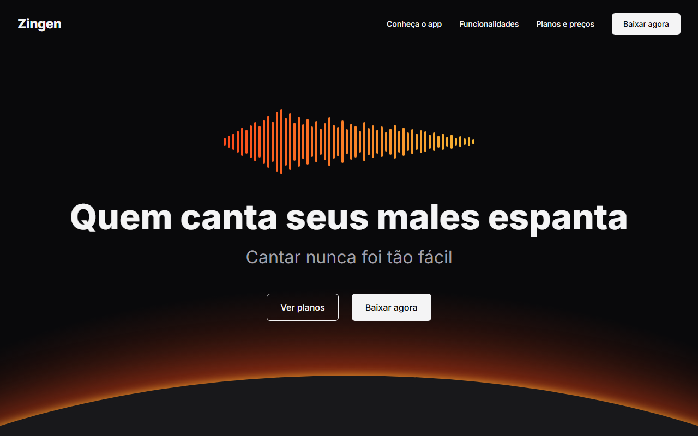
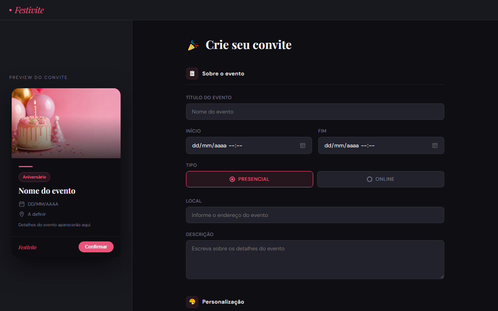
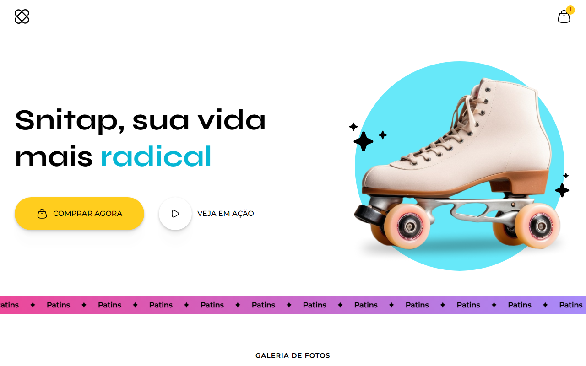
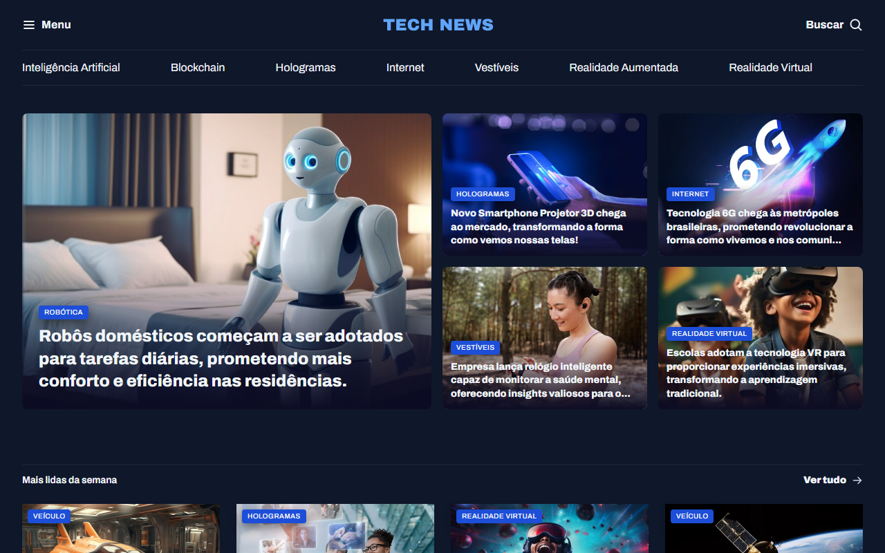
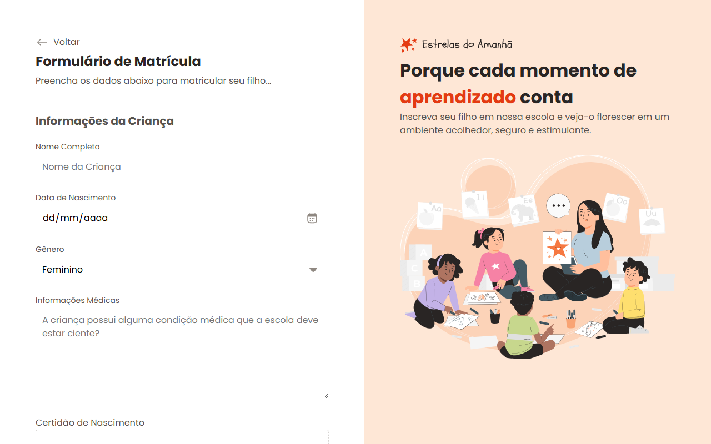
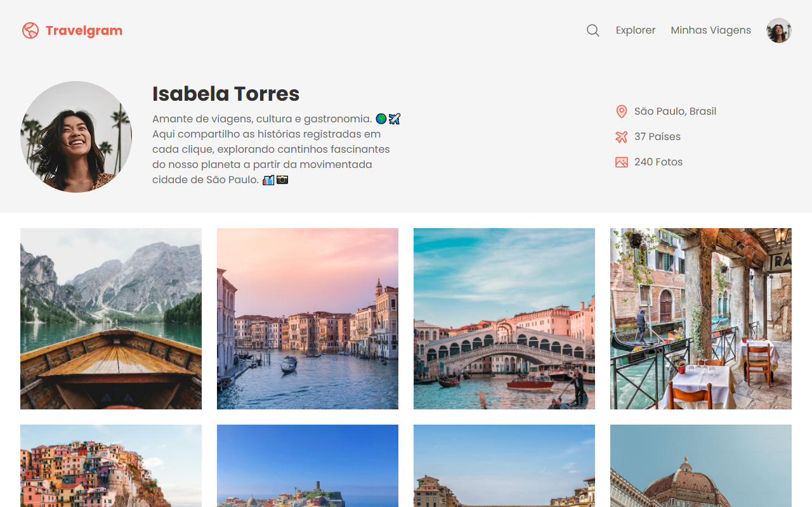
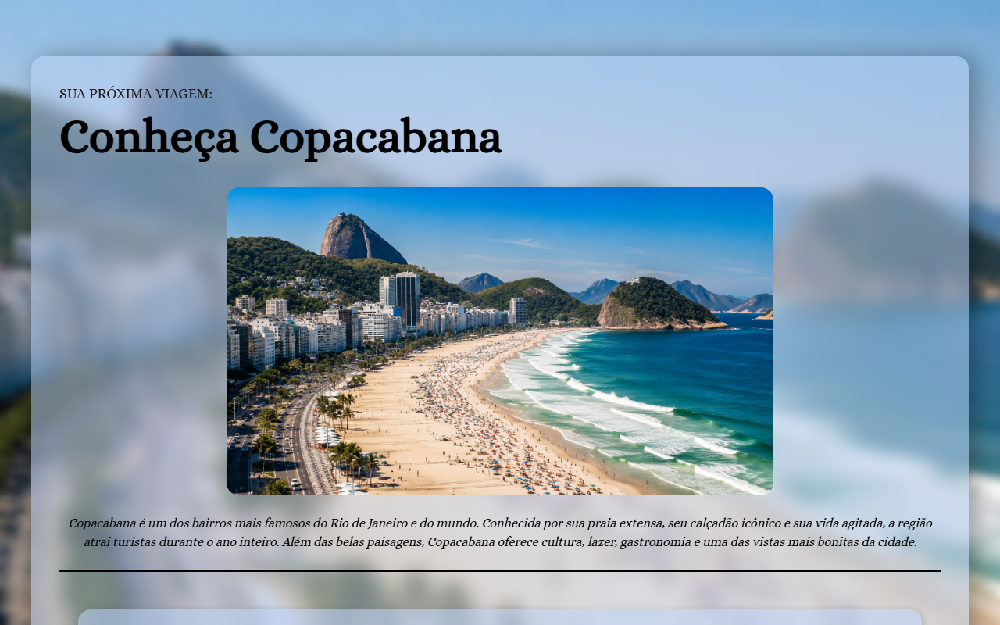
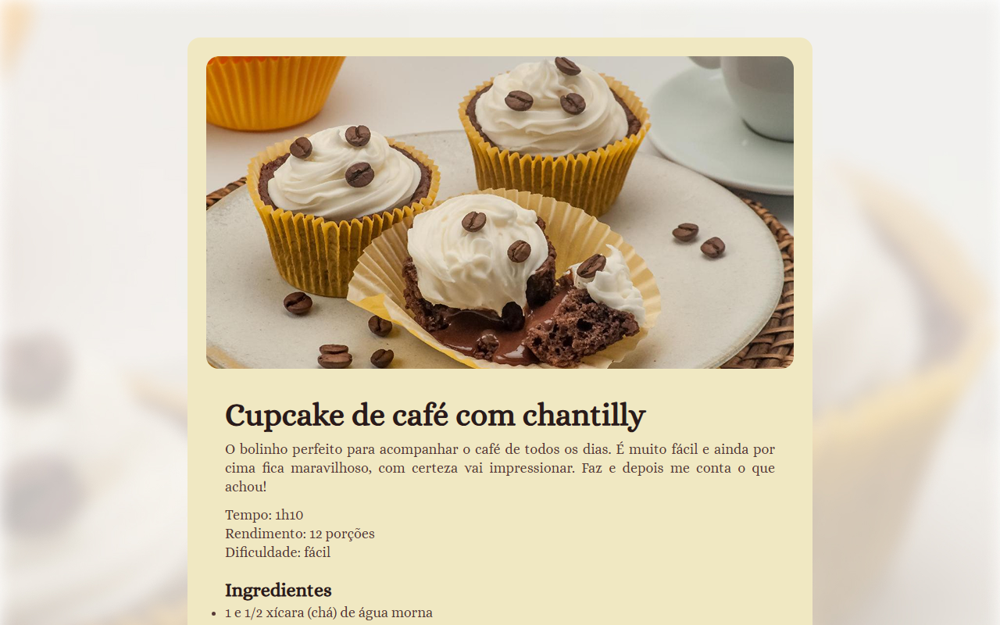

<h1 align="center">🚀 PortR1ck</h1>

<p align="center">
  Meu portfólio de projetos front end, feitos do zero com HTML, CSS e JavaScript.
</p>

<p align="center">
  
  
  
</p>

## 📂 Projetos

### 🎙️ Zingen: Landing Page de Produto
Landing page do Zingen, um app de karaokê com inteligência artificial, feita a partir de um projeto do Figma. Tem hero com onda sonora e horizonte brilhante, cards de funcionalidades com mockups do app, três planos de preço com destaque para o Premium e seção de download. Feita só com HTML e CSS, sem JavaScript.

`HTML` `CSS` `Figma` `Grid` `Responsivo`



🌐 [Ver online](https://r1ckfy.github.io/PortR1ck/LP%20PRODUTO/) &nbsp;·&nbsp; 📁 [Ver código](./LP%20PRODUTO)

### 🎉 Convite de Festa
Criador de convites online com preview em tempo real. Dá para escolher cor, tema do evento, estilo claro ou escuro e enviar uma imagem de capa. Tem validação de formulário e máscara de telefone.

`HTML` `CSS` `JavaScript` `Responsivo`



🌐 [Ver online](https://r1ckfy.github.io/PortR1ck/CONVITE%20DE%20FESTA/) &nbsp;·&nbsp; 📁 [Ver código](./CONVITE%20DE%20FESTA)

### 🛼 Snitap Patins
Landing page de uma marca de patins, com hero animado, galeria de fotos e rodapé com redes sociais.

`HTML` `CSS` `Animações` `Grid` `Responsivo`



🌐 [Ver online](https://r1ckfy.github.io/PortR1ck/LP-PATINS/) &nbsp;·&nbsp; 📁 [Ver código](./LP-PATINS)

### 📰 Portal de Notícias
Portal de notícias de tecnologia com destaque principal, grade de matérias e barra lateral. Layout responsivo para desktop, tablet e celular.

`HTML` `CSS` `Grid` `Responsivo`



🌐 [Ver online](https://r1ckfy.github.io/PortR1ck/PORTAL-DE-NOTICIA/) &nbsp;·&nbsp; 📁 [Ver código](./PORTAL-DE-NOTICIA)

### 📝 Formulário de Matrícula
Formulário de matrícula da escola fictícia Estrelas do Amanhã, com área de upload de arquivos, botões de opção personalizados e campos organizados por seção.

`HTML` `CSS` `Formulários` `Grid`



🌐 [Ver online](https://r1ckfy.github.io/PortR1ck/FORMULARIO%20DE%20MATRICULA/) &nbsp;·&nbsp; 📁 [Ver código](./FORMULARIO%20DE%20MATRICULA)

### ✈️ Travelgram
Perfil de viagens no estilo de rede social, com bio, contadores e galeria de fotos.

`HTML` `CSS`



🌐 [Ver online](https://r1ckfy.github.io/PortR1ck/PROJETO%20TRAVELGRAM/) &nbsp;·&nbsp; 📁 [Ver código](./PROJETO%20TRAVELGRAM)

### 🏖️ Local Turístico
Página sobre Copacabana, com a história do bairro e os lugares para visitar.

`HTML` `CSS`



🌐 [Ver online](https://r1ckfy.github.io/PortR1ck/LOCAL%20TURISTICO/) &nbsp;·&nbsp; 📁 [Ver código](./LOCAL%20TURISTICO)

### 🧁 Receita de Cupcake
Página de receita de cupcake de café com chantilly, com lista de ingredientes e modo de preparo.

`HTML` `CSS`



🌐 [Ver online](https://r1ckfy.github.io/PortR1ck/RECEITA%20CUPCAKE/) &nbsp;·&nbsp; 📁 [Ver código](./RECEITA%20CUPCAKE)

### 🎤 Zinguen Karaokê
Landing page de um app de karaokê. 🚧 Em desenvolvimento.

`HTML` `CSS`

📁 [Ver código](./PROJETO-%20LANDING%20PAGE)

## ▶️ Como rodar

Nenhum projeto precisa de instalação. É só clonar o repositório e abrir o `index.html` de qualquer pasta no navegador.

```bash
git clone https://github.com/r1ckfy/PortR1ck.git
```

Se você usa o VS Code, a extensão **Live Server** abre o projeto com recarregamento automático.

<p align="center">Feito com 💜 por <a href="https://github.com/r1ckfy">r1ckfy</a></p>
